# ALEE — Database Map

Every table in the database, what it holds in plain words, who can see and change it, and how the tables connect.

- **Where the truth lives:** the migration files in `supabase/migrations/`. This page is a guide to them. If the two ever disagree, the migrations are right and this page needs fixing.
- **Keep it current:** whenever a table changes, update this page in the same piece of work (see CLAUDE.md, section 5).
- **Checks:** each area has saved checks in `tests/database/`. Run them with `npm run check:db`.

Last updated: 2026-10-17.

---

## How the tables connect

```mermaid
erDiagram
    auth_users      ||--o| accounts         : "one login, one account"
    accounts        ||--o{ consents         : "agreed to"
    accounts        ||--o| seller_profiles  : "sells as"
    seller_profiles ||--o{ seller_segments  : "deals in"
    segments        ||--o{ seller_segments  : "chosen by sellers"
    segments        ||--o{ products         : "has grades"
    segments        ||--o{ sizes            : "has sizes"
    regions         ||--o{ regions          : "contains (parent)"
    regions         ||--o{ accounts         : "person located in"
    regions         ||--o{ seller_profiles  : "store located in"
    seller_profiles ||--o{ charts           : "owns"
    segments        ||--o{ charts           : "chart for family"
    charts          ||--o{ charts           : "copied from template / replaced by"
    charts          ||--o{ chart_versions   : "saved as"
    chart_versions  ||--o{ chart_version_figures   : "size and loading figures"
    chart_versions  ||--o| chart_version_discounts : "discount"
    sizes           ||--o{ chart_version_figures   : "figure for size"
    seller_profiles ||--o{ seller_grades    : "offers grade"
    products        ||--o{ seller_grades    : "offered by"
    seller_profiles ||--o{ seller_sizes     : "offers size"
    sizes           ||--o{ seller_sizes     : "offered by"
    seller_profiles ||--o{ seller_offering_history : "change log"
    seller_profiles ||--o{ area_setting_versions   : "area setup per family"
    segments        ||--o{ area_setting_versions   : "for family"
    area_setting_versions ||--o{ area_settings     : "one row per area"
    regions         ||--o{ area_settings           : "area (empty = everywhere)"
    charts          ||--o{ area_settings           : "size / loading / discount chart"
    area_settings   ||--o{ area_grade_settings     : "per grade"
    products        ||--o{ area_grade_settings     : "grade"
    seller_profiles ||--o{ publishes               : "publishes"
    publishes       ||--o{ publish_items           : "one per family"
    area_setting_versions ||--o{ publish_items     : "version used"
    publish_items   ||--o{ publish_chart_versions  : "chart versions used"
    chart_versions  ||--o{ publish_chart_versions  : "pinned"
    seller_profiles ||--o{ seller_family_status    : "per family: latest, quoting, closed"
    publishes       ||--o{ seller_family_status    : "latest publish"
    seller_profiles ||--o{ seller_family_status_history : "switches and early closes"
    seller_profiles ||--o{ territory_allocations   : "manufacturer allocates"
    seller_profiles ||--o{ territory_allocations   : "distributor holds"
    segments        ||--o{ territory_allocations   : "for family"
    regions         ||--o{ territory_allocations   : "area"
    territory_allocations ||--o{ territory_allocation_events : "every step"
    brands          ||--o{ brand_families          : "covers"
    segments        ||--o{ brand_families          : "family"
```

In words:

- **A login** (managed by Supabase, in `auth.users`) has at most one **account**. Every personal record hangs off the account.
- **An account** can have many **consents** and at most one **seller profile**.
- **A seller profile** lists the **product families** (segments) the seller deals in, through **seller_segments**.
- **A product family** (segment) has **grades** (products) and one shared list of **sizes**.
- **Regions** form a tree: state → district → taluka → city. Accounts and seller profiles each point to the region where they are.
- **A chart** (size, loading or discount) belongs to one seller and one product family, or to ALEE as a template. Its figures live in **versions**. Each version holds per-size **figures** (size and loading charts) or one **discount** (discount charts).
- **A seller chooses which grades and sizes he sells** (seller_grades, seller_sizes). Every change is logged in seller_offering_history.
- **A seller's area settings** for each product family are saved as **versions**. Each version lists the areas he mentions, with their settings and per-grade settings.
- **A territory allocation** is a manufacturer's area, for one family, offered to and accepted by a distributor. Every step is logged in territory_allocation_events.
- **A publish** is one action by a seller for one or more product families. Per family it records the basic rate and pins the area-settings version and chart versions used. **seller_family_status** points to each family's latest publish and says whether he is quoting, open or closed.

**Deleting a login deletes everything personal.** It removes the account, which removes that person's consents, seller profile, seller product families, grade and size choices with their history, his charts with all their versions, and his area settings with all their versions. This is the only way any of those rows can be deleted. Catalogue, region and template rows are never deleted at all, only switched off.

---

## Area: regions

### `regions` — every place ALEE knows about
One table for states, districts, talukas and cities, each pointing to the place it sits inside.

| Field | Meaning |
|---|---|
| `id` | Permanent identifier. Always look places up by this, never by name (Sangli is a district, a taluka and a city). |
| `name` | Current official name. |
| `level` | `state`, `district`, `taluka` or `city`. |
| `parent_id` | The place it sits inside. A state has none; a district sits under a state; a taluka under a district; a city under a taluka or directly under a district. |
| `alternate_names` | Old names and other spellings, used by search (Aurangabad → Chhatrapati Sambhajinagar). |
| `is_active` | Switched off instead of deleted. |
| `replaced_by_id` | For a switched-off place, the place that replaced it, if any. |
| `is_approved` | New cities added by buyers start unapproved and stay hidden until an admin approves them. |
| `search_text` | Name plus alternate names, kept up to date automatically, for fast search. |

- **Who can see:** anyone sees approved, active places. Admins see all.
- **Who can change:** admins only. Nobody can delete, not even the database owner.
- **Seeded:** Maharashtra (36 districts) and Goa (North Goa, South Goa). Kushavati is deliberately deferred.
- **Search:** `search_regions(query, only_level, max_results)` searches names and old names. It follows the same visibility rules.
- **Checks:** `tests/database/regions.sql`.

---

## Area: catalogue

### `segments` — product families
TMT Bars, MS Angles, MS Channels.

| Field | Meaning |
|---|---|
| `name`, `sort_order` | Display name and position in lists. |
| `short_name` | Short name for display, e.g. "Regular **TMT**". Defaults to the full name if not given. |
| `default_base_unit` | `tonne` or `kg`: the pricing unit a seller starts with when he adds this family. All three default to tonne. |
| `is_active` | Switched off instead of deleted. |

### `products` — grades within a family
For example Fe500, Fe500D and Fe550D within TMT Bars.

| Field | Meaning |
|---|---|
| `segment_id` | The family it belongs to. |
| `name` | Grade name. |
| `is_active` | Switched off instead of deleted. |

Grades carry **no pricing unit**. The unit is chosen by each seller per family (see `seller_segments`).

### `sizes` — sizes within a family, shared by all its grades
For example 8mm–32mm for TMT, 25×3 for angles, ISMC 100 for channels.

| Field | Meaning |
|---|---|
| `segment_id` | The family it belongs to. All grades of the family share this list. |
| `display_name`, `sort_order` | How it is shown and its position. Unique per family, ignoring capitals. |
| `weight_per_metre_kg` | Standard weight of one metre. The basis of every unit conversion. |
| `piece_length_m` | Standard length of one piece. |
| `weight_source` | Where the weight came from (e.g. "IS 1786:2008", or "Calculated" if not in a standard). |
| `is_verified` | The owner has confirmed the weight and length. |
| `is_active` | Switched on for use. **A size cannot be switched on until it is verified.** |

### `sizes_with_piece_weight` (a view, not a table)
The same rows as `sizes`, plus `weight_per_piece_kg` = weight per metre × piece length. Piece weight is calculated every time and never stored, so the two figures can never disagree.

**Catalogue rules**
- **Who can see:** anyone sees active families, grades and sizes. Admins see all.
- **Who can change:** admins only. Nobody can delete.
- **Seeded:**
  - TMT: 3 grades and 7 verified sizes, using IS 1786 weights and 12 m length.
  - Angles: 6 sizes, all unverified and switched off.
  - Channels: 6 sizes (ISMC 75–200), all unverified and switched off.
- **Checks:** `tests/database/catalogue.sql`.

---

## Area: brands

Brands are being added in steps (decisions 2.37 to 2.44). **Step 1 (built):** the brand list. Later steps make sellers' setups, publishing, factories and territory per brand.

### `brands` — ALEE's brand list

| Field | Meaning |
|---|---|
| `name` | The brand's name. No two live brands share a name, ignoring capitals. |
| `is_regular` | The one unbranded option, **Regular**. It covers every family, is never owned, and is shown as "Regular TMT". It can't be rejected, switched off or duplicated. |
| `alternate_names` | Old names and other spellings, used for search and to catch duplicate requests. |
| `status` | `requested` → `approved` or `rejected`. The decision is final; a rejected name can be requested again as a new request, and the old one stays. |
| `requested_by`, `decided_by`, `decided_at` | Who asked for it, and which admin decided, when. |
| `is_active` | Switched off instead of deleted. |

### `brand_families` — which product families a brand covers
Regular has no rows here, because it covers every family.

### How brands are added
- **`request_brand(name, families)`:** a seller asks for a missing brand. If the name, or one of its known spellings, is already on ALEE or already requested, it's refused in plain words: "check tiscon is already on ALEE (as Check Tiscon)."
- **`decide_brand(brand, approve)`:** an admin approves or rejects a request.
- **Direct edits:** admins can also add brands, spellings and families directly.
- **`brand_covers_family(brand, family)`:** whether a brand covers a family; Regular covers all of them.
- **`brand_display_name(brand, family)`:** how a brand is shown. "Regular TMT" for Regular, otherwise its own name. The one place this is decided.

### Who can see and change
- **Approved, active brands** and their families: anyone.
- **A request:** only the seller who made it, and admins.
- **Changes:** only admins change brands. Nothing is ever deleted, not even with the master key.
- **Checks:** `tests/database/brands.sql`.

### Ownership (step 2): `brands.owner_id` and `brand_claims`
- **`brands.owner_id`:** the manufacturer who owns the brand. Public.
  - **Set only by approving a claim:** not even an admin or the master key can set it directly.
  - **Never Regular:** Regular is never owned.
  - **Several brands:** one manufacturer can own several.
- **`brand_claims`:** every claim to own a brand.
  - **What it records:** brand, claimant and time, and status `claimed` → `approved` or `rejected`; `approved` → `ended`. It also records who decided and when, and who ended it and when.
  - **History:** the status only moves forward, and claims are never deleted.
  - **Who sees them:** the claimant and admins.
- **`claim_brand(brand)`:** a seller claims an approved brand that has no owner. Plain refusals, e.g. "Check Steel already has an owner. If you believe it is yours, contact ALEE."
- **`decide_brand_claim(claim, approve)`:** an admin approves, making the claimant the owner, or rejects. A brand that already has an owner must have it ended first.
- **`end_brand_ownership(brand)`:** an admin ends ownership, for example when a brand is sold.
- **Checks:** `tests/database/brand_ownership.sql`.

### Brand lines (step 3): `seller_brands`
Which brands each seller sells, per product family, e.g. *Bala Traders – Tata – TMT*. Each brand line will get its own setup, rates and status in the next steps.

| Field | Meaning |
|---|---|
| `seller_id`, `brand_id`, `segment_id` | Who, which brand, which family. Never change. |
| `is_active` | Switched off when he stops selling it; never deleted. |

- **What can be added:** only an approved brand that covers the family, in a family the seller deals in. Refusals are in plain words: "Check Tiscon is not listed for MS Angles."
- **No owner needed:** any seller can sell any approved brand, even one with no owner on ALEE.
- **Who sees and changes:** anyone sees active brand lines. The seller and admins add and change them.
- **Copying a brand's setup (step 7):** `copy_brand_setup(family, from brand, to brand, seller)` makes one brand line's grades, sizes and area settings match another's in one call.
  - **Shared charts:** the copy points at the same charts, which are shared rather than duplicated.
  - **Zero and not set:** "not set" and zero are kept apart.
  - **Unit changes:** if his unit for the family changed since the source was saved, amounts are converted exactly or the copy is refused.
  - **Afterwards:** the two brands are separate. Copying again overwrites the target, and its old versions are kept.
- **Transitional (decisions 2.44, removed in step 11):** adding a product family automatically adds a **Regular** brand line for it, so everything built before brands keeps working. Existing sellers' families were carried across as Regular lines.
- **Checks:** `tests/database/seller_brands.sql`.

### Factories (step 8)
A brand can have several factories. Each is its own seller account, with its own rates, setup and closing time.

| Table | What it holds |
|---|---|
| `brand_factories` | A factory account linked to a brand. `offered` → `active` (the factory accepted), `declined`, or `withdrawn` (the owner took it back); `active` → `left` (the factory left) or `ended` (the owner ended it). Moves forward only; brand and factory never change. |
| `brand_factory_events` | Every step of a link, with time, who and whether an admin. Never changed. |
| `factory_coverage_versions` | Saved versions of which factory covers which area, **per brand and product family**, with who saved it. Never edited. |
| `factory_coverage_areas` | One factory per area in a version. Empty region = "everywhere", chosen explicitly. |

- **Linking:**
  - **`offer_factory_link(brand, factory)`:** only the brand's owner, or an admin, offers.
  - **`respond_to_factory_link(link, accept)`:** only the factory accepts or declines.
  - **`end_factory_link(link)`:** the factory leaves, or the owner ends the link or withdraws an offer.
- **`save_factory_coverage(brand, family, areas)`:** only the owner (or an admin) saves. Every factory named must be linked (active) and must sell that brand in that family. Refusals are plain: "Farid Steel does not sell Check Steel Angles yet."
- **`resolve_brand_factory(brand, family, area)`:** the factory serving a buyer's area, where the closer area wins. If that factory has since left, it says so (`factory_is_linked` false): the area isn't served until the owner reassigns it. There's never a quiet fall-back to another factory.
- **Who sees:** the owner, the brand's linked factories and admins. Other sellers, buyers and visitors see nothing; to buyers the brand appears as one brand.
- **Account deletion:** if a factory account is deleted, its coverage rows go with it (see the open question on account deletion).
- **Checks:** `tests/database/factories.sql`.

---

## Area: accounts and sellers

### `accounts` — one per person
Linked to the person's login; same identifier.

| Field | Meaning |
|---|---|
| `id` | Same as the login. Deleting the login deletes the account and everything linked to it. |
| `full_name`, `firm_name` | Person and firm. |
| `phone` | Indian mobile, `+91…`. For an ordinary user it must be the number they logged in with. |
| `gst_number` | Recorded as entered; not verified. |
| `signup_role` | `manufacturer`, `distributor`, `wholesaler` or `retailer`. Only decides the first home screen; everyone can buy and sell. |
| `region_id` | Where the person is located. |

- **Who can see:** only the person and admins. Visitors who are not logged in cannot read this table at all. This is enforced by the database, not by the screens.
- **Who can change:** the person changes their own; admins can create and change any (the owner sets up the first sellers). No one can delete an account directly; it goes when the login is deleted.
- **Helper:** `current_login_phone()` returns the caller's own verified login phone. It is used to enforce the phone rule and never reveals anyone else's number.

### `consents` — what each person agreed to
An add-only log.

| Field | Meaning |
|---|---|
| `account_id` | Whose consent. |
| `purpose` | What was agreed to, one row per purpose (e.g. `terms_of_use`, `privacy_notice`). |
| `notice_version` | Which version of the notice they saw. |
| `granted` | `true` = agreed, `false` = withdrew (a withdrawal is a new row). |
| `recorded_at` | Set by the database to the moment of saving; cannot be back-dated. |

- **Who can see:** only the person and admins.
- **Who can add:** only the person, for themselves. Admins cannot record consent on someone's behalf.
- **Never changed:** no one can edit a row or delete one on its own, not even the database owner. Rows go only when the login is deleted.

### `seller_profiles` — one per person who sells
The public face of a seller.

| Field | Meaning |
|---|---|
| `account_id` | The seller's account; same identifier. |
| `store_name`, `description` | Shown publicly. |
| `banner_path` | Where the banner picture is kept in file storage. Storage is set up later. |
| `region_id` | Where the store is. |
| `market_close_time` | Daily closing time, Indian time. Empty until set. |
| `is_public` | Public: subscribers see rates at once. Private: each subscription needs approval. Must be chosen; there is no default. |

- **Who can see:** anyone, including private profiles. The profile holds no phone or contact details; those stay in `accounts`.
- **Who can change:** the seller changes his own; admins can create and change any. It cannot be deleted on its own.

### `seller_segments` — which families each seller deals in
And the unit he prices each in.

| Field | Meaning |
|---|---|
| `seller_id` | The seller (his account / profile). |
| `segment_id` | The family. |
| `base_unit` | `tonne` or `kg`. **This is the only pricing unit in ALEE.** It starts from the family's default; the seller may change it. |
| `is_active` | A seller who stops dealing in a family is switched off, not removed. |

- **Who can see:** anyone sees active rows. The seller and admins see all of his.
- **Who can change:** the seller changes his own; admins can change any. A switched-off family cannot be added. A row cannot be deleted on its own.
- **Checks:** `tests/database/accounts.sql` covers all four tables in this area.

---

## Area: charts

A seller's size differences, loading and trade discount are kept in named **charts**. A chart's figures are never edited: every save creates a new **version**, so any past rate can be rebuilt exactly as it was.

### `charts` — a named chart
One seller, one product family, one type.

| Field | Meaning |
|---|---|
| `seller_id` | The seller who owns it. Empty for an ALEE template. |
| `is_template` | An ALEE template. Sellers copy templates; they never use them directly. |
| `segment_id` | The product family. Fixed once created. |
| `chart_type` | `size`, `loading` or `discount`. Fixed once created. |
| `name` | No two active charts of the same seller, family and type share a name. |
| `copied_from_template_id` | Which template a seller's chart was copied from. Information only: the copy is fully separate. |
| `in_use_since` | When a publish first used this chart. Set only by the publish engine, never through the app, and never cleared. |
| `replaced_by_id` | For a switched-off chart, the chart that replaced it: same seller, family and type, and active. |
| `is_active` | Switched off instead of deleted. **A chart that a publish has used can be switched off only by naming its replacement.** |

### `chart_versions` — each saved state of a chart

| Field | Meaning |
|---|---|
| `chart_id` | The chart. |
| `version_number` | 1, 2, 3… per chart. |
| `unit` | `tonne` or `kg`: the unit of every figure in this version, so a figure is never ambiguous. |
| `created_at` | When it was saved. Set by the database. |

### `chart_version_figures` — the figures of a size or loading chart version

| Field | Meaning |
|---|---|
| `version_id` | The version. |
| `size_id` | The size this figure is for. **Size chart:** always a size from the chart's own product family, each size at most once. **Loading chart:** exactly one row with no size (the figure for all sizes), plus optional rows for particular sizes. |
| `amount` | Exact rupees per the version's unit. Positive, negative or **zero; zero means "same as base" and is stored as 0, never left empty.** |

### `chart_version_discounts` — the discount of a discount chart version

| Field | Meaning |
|---|---|
| `version_id` | The version (one discount per version). |
| `kind` | `flat` or `percent`. |
| `flat_amount` | For flat: exact rupees per the version's unit. Never negative. |
| `percent` | For percent: from 0 to 100. |

### How charts are written
Figures are written only by two functions, so a version is always complete when saved and nothing can be added to it later:

- **`save_chart_version(chart, unit, figures, discount)`** saves a new version and returns its id. A seller may save only his own charts. Only admins may save templates. Admins may also save any seller's chart, to set sellers up. A switched-off chart cannot be saved.
- **`copy_template(template, name, seller)`** copies an active template's latest version into a new chart owned by the seller. It records which template it came from. Later changes to the template never reach the copy. A seller copies for himself; an admin may copy for any seller.
  - **Converted into the seller's unit:** the seller must deal in the template's product family. The copy is saved in his unit for that family: ₹6,500/tonne becomes ₹6.5/kg; flat discounts convert the same way; percentages don't change.
  - **Exact or refused:** if any figure can't be converted exactly to 4 decimal places, the whole copy is refused and nothing is left behind.
- **Which figure applies to a buyer** is worked out per size by `resolve_size_figures` (see area settings below). A size chart only needs the sizes that differ for its area.

### Who can see and change charts
- **Seller:** sees and changes only his own charts. Another seller gets nothing back, even when asking for a chart by its id.
- **Templates:** any logged-in seller sees active templates. Only admins create or change them.
- **Admins:** see and change all charts.
- **Visitors:** see nothing yet. Once area settings exist, visitors will see only the charts for their own area.
- **Never changed, never deleted:** no one can change or delete a saved version or figure, not even the database owner. No one can delete a chart. A seller's charts go only when his whole account is deleted.
- **Checks:** `tests/database/charts.sql` (rules, using test data) and `tests/database/templates.sql` (the real shipped templates).

### Templates shipped with ALEE
| Template | Type | Figures |
|---|---|---|
| Standard TMT – Maharashtra & Goa | TMT Bars size chart, per tonne | 8mm 6,500 · 10–25mm 5,500 · 32mm 6,500 |

No loading template is shipped; each seller enters his own loading (decisions 2.16).

---

## Area: what each seller offers

For each brand he sells in a product family (each brand line), a seller explicitly chooses which grades and which sizes he sells. **Nothing is selected by default, and anything not selected is "not offered" to his buyers.**

- **One brand at a time:** every choice, and every history entry, carries the brand (`brand_id`). Choices for one brand never affect another.
- **Needs an active brand line:** choosing requires one ("Add Check Rods to the brands you sell first."). Unselecting is always allowed.
- **Transitional (until brands step 11):** a choice saved without a brand, and "select all" without one, mean Regular.

### `seller_grades` and `seller_sizes` — his current choices
One row per seller per grade (`product_id`) or per size (`size_id`).

| Field | Meaning |
|---|---|
| `seller_id` | The seller. |
| `product_id` / `size_id` | The grade or size. |
| `is_selected` | Offered or not. **No row, or `false`, means not offered.** Unselecting sets `false`; rows are never deleted. |

- **What can be selected:** only active grades and sizes, in a product family the seller currently deals in. Unselecting is always allowed.
- **Select all:** `select_all_in_family(family, 'grades' or 'sizes', selected, seller, brand)` selects or unselects every grade or size of one family, for one brand. It returns how many choices changed.
- **New sizes:** "select all" covers what is switched on in the catalogue now. A size switched on later starts unselected for every seller.
- **Who can see:** anyone sees what a seller offers (selected rows only). The seller and admins see all his choices.
- **Who can change:** the seller changes his own; admins can change any seller's, to set sellers up.

### `seller_offering_history` — every change, kept forever

| Field | Meaning |
|---|---|
| `seller_id` | The seller. |
| `product_id` or `size_id` | The grade or size (exactly one). |
| `is_selected` | What it was changed to. |
| `changed_at` | When. |
| `changed_by` | Who: the seller himself, or the admin who made the change. |

- **Written automatically** whenever a choice actually changes. Nobody can write, change or delete it directly, not even the database owner. It goes only when the seller's whole account is deleted.
- **Who can see:** the seller and admins.
- **Checks:** `tests/database/offerings.sql`.

---

## Area: area settings

What a seller attaches to areas, per product family: area difference, charts, grade premium, display unit, exclusions and grades not sold (CLAUDE.md sections 8 and 9). **Private: only the seller and admins can read them**, because they reveal his margins by area. Buyers will only ever see their own final rate, through the rate engine.

**"Not set" and zero:** throughout these tables an empty field means **not set**, and the setting carries down from the area above. A value, **including 0**, means set here. Zero never carries down.

**Brands:** all of this is per brand line. Until brands step 11, a save or lookup without a brand means Regular, and publishing uses the Regular line (step 6 gives publishes a brand).

**Not set anywhere:** the lookups return empty, never 0. For loading, area difference, grade premium and size difference, empty means **missing**: the rate engine must flag it and leave that price out, never price it at zero. A seller who means zero enters 0. Only a missing discount simply means no discount (decisions 2.24).

### `area_setting_versions` — each saved area setup

| Field | Meaning |
|---|---|
| `seller_id`, `brand_id`, `segment_id` | Whose setup, for which brand and product family (the brand line). Each brand has its own versions; charts stay per seller and family, so two brands can point at the same chart. |
| `version_number` | 1, 2, 3… per seller, brand and family. A publish will record which version it used. |
| `unit` | `tonne` or `kg`: the unit of every amount in this version (the seller's unit for the family when saved). |
| `created_at` | When it was saved. |

### `area_settings` — one row per area mentioned in a version
An area the version doesn't mention has no row; everything carries down to it from above.

| Field | Meaning |
|---|---|
| `version_id` | The version. |
| `region_id` | A state, district, taluka or city. **Empty = "everywhere"**, the level above every state. It is only written when the seller explicitly chooses it. |
| `is_excluded` | Not served here. An excluded area carries no other settings. |
| `area_difference` | Exact rupees in the version's unit. Empty = not set; 0 = zero. May be negative. |
| `size_chart_id`, `loading_chart_id`, `discount_chart_id` | The seller's own active charts of that type and family. Empty = not set. |
| `display_unit` | `tonne`, `kg`, `piece` or `metre`. Empty = not set. |

### `area_grade_settings` — per-grade settings within one area

| Field | Meaning |
|---|---|
| `area_setting_id` | The area (within a version). |
| `product_id` | The grade, from the same product family. |
| `grade_premium` | Exact rupees. Empty = not set; 0 = no premium, set here. |
| `size_chart_id` | A size chart just for this grade in this area. Empty = not set. |
| `is_sold` | `false` = not sold here; `true` = sold here (overrides a broader "not sold"); empty = not set. If never set, the grade is sold. |

### How area settings are written and looked up
- **`save_area_settings(family, areas, seller, brand)`** is the only way to save. The seller must sell that brand in that family ("Add Check Rods to the brands you sell first."). It saves the whole setup as a new, complete version and returns its id.
  - "Everywhere" must be given as `"everywhere": true`. An area with no region is refused.
  - A misspelt setting name is refused, so a typo can never become "not set".
  - An empty list means the seller serves nowhere.
  - A seller saves his own; an admin may save for any seller.
- **`resolve_area_settings(seller, family, area, grade, version, brand)`** looks up the settings that apply to the whole area: served or not, area difference, discount chart, display unit, grade premium, and whether the grade is sold. One query; latest version unless one is given.
  - **Order:** each setting is looked up separately, most specific first: city, taluka, district, state, everywhere. The first value actually set wins, so 0 is used and never skipped.
  - **Served:** decided by the most specific area the seller mentioned. An exclusion there beats any broader area, including "everywhere". Nothing mentioned means not served. A city named inside an excluded district is served.
  - **Not served:** every setting comes back empty, so nothing is revealed.
  - **No size or loading figures:** it deliberately returns none; those are per size.
- **`resolve_size_figures(seller, family, area, grade, version, publish, brand)`** looks up, for one brand line, size differences and loading **one size at a time**. It returns one row per size switched on in the family, and no rows if the area isn't served.
  - **Size difference:** for each size, closest area first. At each area, the grade's own size chart is looked at first (if that area gives the grade one), then the area's family size chart. The first figure found wins. Example: Maharashtra 8mm 6,500, 10mm/12mm 5,500; Satara 10mm/12mm 5,000 → a Satara buyer gets 8mm 6,500 (Maharashtra) and 10mm/12mm 5,000 (Satara).
  - **Loading:** for each size, the closest area with a loading chart answers. It uses that chart's figure for the size, or else its all-sizes figure.
  - **For each size it reports** the figure, its unit (the chart's), where it came from (area name or "everywhere"), whether it came from the grade's chart or the family chart, and whether the seller offers the size.
  - **`is_missing`:** marks a size the seller offers that has no figure anywhere. **That is an error, never zero:** publishing must flag it and leave the size out.
  - **Chart versions:** each chart's latest version is used. A publish must record which chart versions it used.
- **Whose settings:** today only the seller and admins can use either lookup. The rate engine will call them for buyers and return only the final rate. Territory allocation (not built yet) will be checked first.

### Who can see and change
- **Seller:** reads and saves only his own.
- **Admins:** read and save any seller's.
- **Everyone else** (other sellers, buyers, visitors): reads nothing and cannot look settings up.
- **Never changed, never deleted:** no one can change, add to or delete a saved version, not even the database owner. A seller's settings go only when his whole account is deleted.
- **Checks:** `tests/database/area_settings.sql` (settings, privacy, versions) and `tests/database/size_figures.sql` (per-size figures, the Maharashtra/Satara example).

---

## Area: publishing

### `publishes` — one per publish
One action by a seller, covering one or more product families, so buyers get one notification.

| Field | Meaning |
|---|---|
| `publish_number` | Strict order of publishes. |
| `seller_id` | Whose rates. |
| `published_at` | Set by the database at the moment of publishing; can never be back-dated. |
| `published_by`, `by_admin` | The login that published: the seller, or an admin on his behalf during setup. |
| `is_correction`, `corrects_publish_id` | Marks a publish that corrects an earlier one, optionally naming which (always the seller's own). The earlier one stays, unchanged. |

### `publish_items` — one per brand line in a publish

| Field | Meaning |
|---|---|
| `brand_id`, `segment_id` | The brand and product family (the brand line). One publish can cover many brands and families, and is still one notification. |
| `base_rate` | The seller's basic rate: exact rupees, above zero. **Private.** |
| `unit` | `tonne` or `kg`: the seller's unit for the family at the time. |
| `area_setting_version_id` | The area-settings version in force. |

### `publish_chart_versions` — the exact chart versions used
One row per chart that the area settings pointed to, pinned to the version that was latest at the moment of publishing. With the area-settings version, this lets any past rate be rebuilt exactly.

### `seller_family_status` — the current state per brand line (seller, brand, family)
**Public; holds no rate.**

| Field | Meaning |
|---|---|
| `latest_publish_id`, `last_published_at` | The latest publish: the quick way to a seller's current rate. The rate engine works out the buyer's figure from it; final rates are not pre-calculated. |
| `is_quoting` | `false` = "not quoting today": buyers see "not quoting" and no figure. Stays off until the seller switches it back on or publishes that family (publishing switches it on, recorded in the history). |
| `closed_early_at` | The latest "close market now". It closes the family only if it came after the latest publish. |

### `seller_family_status_history` — every switch and early close
`stopped_quoting`, `resumed_quoting` or `closed_early`, with when it happened, who did it and whether it was an admin. Add-only; seen by the seller and admins.

### How publishing works
- **`publish_rates(items, is_correction, corrects, seller)`** is the only way to publish. Each item is `{segment_id, brand_id, base_rate}`; the seller must sell that brand there, and each brand line appears once. Refusals name the brand: "Choose where you sell Check Rods TMT before publishing." (For Regular they name the family, "TMT Bars".) A problem on one brand line never blocks another.
  - **The seller must** have a daily closing time set.
  - **Each family must** be one the seller deals in, with area settings saved, and no switched-off chart in use. The rate must be above zero.
  - **Refusals are in plain words** naming the family, area and chart (decisions 2.32), e.g. "Satara still uses 'Old TMT rates', which you switched off. Choose a chart for Satara."
  - **What it does:** pins the versions, marks the charts used ("used since"), and updates the status. A new publish reopens a closed market and switches "not quoting" back on, recorded in the history.
  - **Who:** a seller publishes for himself; an admin may publish for any seller, recorded as such.
- **Rebuilding a past rate:** `resolve_area_settings(..., version = the publish's area-settings version)` and `resolve_size_figures(..., publish)` give exactly what that publish used.
- **`market_status(seller, family, at, brand)`** is the one place open/closed is worked out. Anyone can call it. It answers `not_published`, `not_quoting`, `open` or `closed` (with the closing time), now or at any given moment.
  - **Closed** means that, after the latest publish, either the seller's daily closing time (Indian time) has passed or he pressed "close market now".
  - **Published after today's closing time:** it stays open until tomorrow's.
  - **Closing time required:** a seller needs one before his first publish (the setup screen pre-fills 6:00 PM). After publishing he can change it but not clear it, not even with the master key.
- **`set_quoting(family, on/off, seller, brand)`** is the "not quoting today" switch. Switching to the state it's already in records nothing.
- **`close_market_now(families, seller, brands)`** closes the given families and brands now; if none are named, every brand line he sells. Only families currently open are closed and recorded.

**Brands:** until brands step 11, an item, switch or lookup without a brand means Regular. Publishing one brand line reopens and resumes only that line.

### Who can see and change
- **Basic rates, publishes and pinned versions:** the seller and admins only. Other sellers, buyers and visitors get nothing, even asking the database directly. Buyers will only ever see their own final rate, through the rate engine.
- **Quoting, open and closed:** anyone (`seller_family_status`, `market_status`). The switch and close history: the seller and admins.
- **Never changed, never deleted:** no one can change, add to or delete a publish or its pinned versions, not even with the master key. They go only if the seller's whole account is deleted (see decisions, open questions).
- **Checks:** `tests/database/publishes.sql`.

---

## Area: territory allocation

A manufacturer allocates an area, for one product family, to a distributor. It takes effect only once the distributor accepts. The rate engine checks territory **first**, before exclusions and area settings.

### `territory_allocations` — one row per offer
Each row is followed through to its end.

| Field | Meaning |
|---|---|
| `manufacturer_id`, `distributor_id` | The two sides. Never the same seller. |
| `segment_id` | The product family. |
| `region_id` | The area: state, district, taluka or city. The closer area wins. |
| `allocation_type` | `distributor_prices` (Type A): the manufacturer's rate isn't shown there; buyers are pointed to the distributor, who publishes his own rates. `manufacturer_prices` (Type B): the manufacturer's rate is shown, tagged "Authorised distributor for [area]: [distributor]"; enquiries from there go to the distributor. Can change only while it's an offer. |
| `status` | `offered` (no effect yet) → `active` (accepted, in effect), `declined` (never took effect), or `withdrawn` (the manufacturer took the offer back). `active` → `ended` (by either side). It only moves forward; finished allocations are never revived. |
| `offered_at`, `accepted_at`, `closed_at` | When it was offered, accepted, and finished. |

- **One open allocation** (offered or active) per manufacturer, family and area: a second distributor can't be given the same area and family. Different families can go to different distributors.
- **Fixed once offered:** the manufacturer, distributor, family, area and offer time never change, not even with the master key. To change them, offer a new allocation.

### `territory_allocation_events` — every step, kept forever
`offered`, `type_changed`, `accepted`, `declined`, `withdrawn` or `ended`, with the type at that moment, when, who did it, and whether it was an admin. Nobody can change or delete it.

### How territory is changed and looked up
These are the only ways to change an allocation:
- **`offer_territory(distributor, family, area, type, manufacturer)`:** the manufacturer offers (an admin may offer for him). He must sell the family himself. Refusals are in plain words, e.g. "Satara TMT Bars is already offered to or held by Bala Traders. End that first."
- **`change_territory_type(allocation, type)`:** the manufacturer changes the type, only while it's an offer.
- **`respond_to_territory(allocation, accept)`:** the distributor accepts or declines.
- **`end_territory(allocation)`:** either side ends an active allocation; the manufacturer can withdraw an offer. The manufacturer's own rate then shows again there, if he serves it.

**`resolve_territory(manufacturer, family, buyer's area)`** is the one lookup the rate engine uses.
- **Single query:** it returns the allocation in effect closest to the buyer (to whom, which type, for which area), or nothing.
- **Public, and no rates:** anyone can call it, and it never returns a rate.

### Who can see and change
- **Allocations in effect:** anyone, because buyers will see the tags and be pointed to distributors.
- **Offers, declines, withdrawals, endings and the history:** only the manufacturer, the distributor and admins.
- **No rates anywhere:** nothing here holds a rate, amount or margin. The manufacturer can't read a distributor's publishes, rates, area settings or charts by any route; the saved checks try each one.
- **Checks:** `tests/database/territory.sql`.

---

## Shared machinery

| Name | What it does |
|---|---|
| `is_admin()` | True when the logged-in user's login is marked admin (`app_metadata.role = 'admin'`, which users cannot set themselves). Used by every admin rule. |
| `set_updated_at()` | Keeps `updated_at` current on every table that has one. |
| `prevent_delete()` | Blocks deletes on catalogue tables (segments, products, sizes), for everyone. |
| `prevent_direct_delete()` | Blocks deletes on personal tables except when the whole account is being deleted. |
| `prevent_update()` | Blocks every change to rows that must never change once saved (chart versions and their figures), for everyone. |
| `convert_per_unit(amount, from, to)` | The one place an amount is converted between per tonne and per kg. Exact to 4 decimal places or refused. Piece and metre need a size's weight and belong to the rate engine. |
| `resolve_territory(manufacturer, family, area)` | The territory allocation in effect closest to a buyer, if any. Public; no rates. The rate engine checks it first. |
| `market_status(seller, family, at)` | Open, closed, not quoting or not published, now or at any moment. Public. The market status engine. |
| `rupees` | Every money amount. Exact, up to 4 decimal places. More precision is refused, never rounded. |
| `percentage` | Exact, from 0 to 100. |
| `unit` | The four units: `tonne`, `kg`, `piece`, `metre`. Pricing uses only tonne or kg; piece and metre are for display. |
| `region_level` | `state`, `district`, `taluka`, `city`. |
| `account_role` | `manufacturer`, `distributor`, `wholesaler`, `retailer`. |
| `chart_type` | `size`, `loading`, `discount`. |
| `discount_kind` | `flat`, `percent`. |

---

## Not built yet

These appear in CLAUDE.md but have no tables yet:

- the rate engine itself (it will use `resolve_area_settings`, `resolve_size_figures` and `convert_per_unit`)
- the area setup screen (it must show a plain coverage summary, e.g. "Kolhapur district: not served, except Kolhapur city")
- notifications on publish (one per publish)
- enquiries (an enquiry after close must be marked "received after close", and the buyer told the seller will respond when the market opens; an enquiry from a Type B territory area goes to the authorised distributor)
- subscriptions, enquiries, orders, bills
- client book
