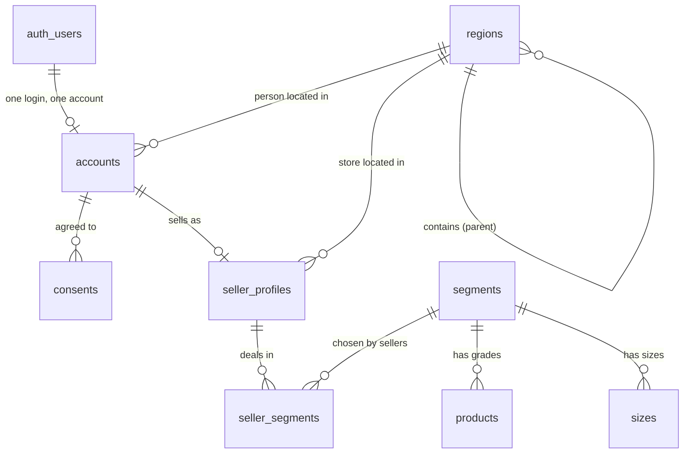

# ALEE — Database Map

Every table in the database, what it holds in plain words, who can see and change it, and how the tables connect.

- **Where the truth lives:** the migration files in `supabase/migrations/`. This page is a guide to them. If the two ever disagree, the migrations are right and this page needs fixing.
- **Keep it current:** whenever a table changes, update this page in the same piece of work (see CLAUDE.md, section 5).
- **Checks:** each area has saved checks in `tests/database/`. Run them with `npm run check:db`.

Last updated: 2026-10-17.

---

## How the tables connect

In words:

- **A login** (managed by Supabase, in `auth.users`) has at most one **account**. Every personal record hangs off the account.
- **An account** can have many **consents** and at most one **seller profile**.
- **A seller profile** lists the **product families** (segments) the seller deals in, through **seller_segments**.
- **A product family** (segment) has **grades** (products) and one shared list of **sizes**.
- **Regions** form a tree: state → district → taluka → city. Accounts and seller profiles each point to the region where they are.

**Deleting a login deletes everything personal.** It removes the account, which removes that person's consents, seller profile and seller product families. This is the only way any of those rows can be deleted. Catalogue and region rows are never deleted at all, only switched off.

---

## Area: regions

### `regions` — every place ALEE knows about
One table for states, districts, talukas and cities, each pointing to the place it sits inside.

| Field | Meaning |
|---|---|
| `id` | Permanent identifier. Always look places up by this, never by name (Sangli is a district, a taluka and a city). |
| `name` | Current official name. |
| `level` | `state`, `district`, `taluka` or `city`. |
| `parent_id` | The place it sits inside. A state has none; a district sits under a state; a taluka under a district; a city under a taluka or directly under a district. |
| `alternate_names` | Old names and other spellings, used by search (Aurangabad → Chhatrapati Sambhajinagar). |
| `is_active` | Switched off instead of deleted. |
| `replaced_by_id` | For a switched-off place, the place that replaced it, if any. |
| `is_approved` | New cities added by buyers start unapproved and stay hidden until an admin approves them. |
| `search_text` | Name plus alternate names, kept up to date automatically, for fast search. |

- **Who can see:** anyone sees approved, active places. Admins see all.
- **Who can change:** admins only. Nobody can delete, not even the database owner.
- **Seeded:** Maharashtra (36 districts) and Goa (North Goa, South Goa). Kushavati is deliberately deferred.
- **Search:** `search_regions(query, only_level, max_results)` searches names and old names. It follows the same visibility rules.
- **Checks:** `tests/database/regions.sql`.

---

## Area: catalogue

### `segments` — product families
TMT Bars, MS Angles, MS Channels.

| Field | Meaning |
|---|---|
| `name`, `sort_order` | Display name and position in lists. |
| `default_base_unit` | `tonne` or `kg`: the pricing unit a seller starts with when he adds this family. All three default to tonne. |
| `is_active` | Switched off instead of deleted. |

### `products` — grades within a family
For example Fe500, Fe500D and Fe550D within TMT Bars.

| Field | Meaning |
|---|---|
| `segment_id` | The family it belongs to. |
| `name` | Grade name. |
| `is_active` | Switched off instead of deleted. |

Grades carry **no pricing unit**. The unit is chosen by each seller per family (see `seller_segments`).

### `sizes` — sizes within a family, shared by all its grades
For example 8mm–32mm for TMT, 25×3 for angles, ISMC 100 for channels.

| Field | Meaning |
|---|---|
| `segment_id` | The family it belongs to. All grades of the family share this list. |
| `display_name`, `sort_order` | How it is shown and its position. Unique per family, ignoring capitals. |
| `weight_per_metre_kg` | Standard weight of one metre. The basis of every unit conversion. |
| `piece_length_m` | Standard length of one piece. |
| `weight_source` | Where the weight came from (e.g. "IS 1786:2008", or "Calculated" if not in a standard). |
| `is_verified` | The owner has confirmed the weight and length. |
| `is_active` | Switched on for use. **A size cannot be switched on until it is verified.** |

### `sizes_with_piece_weight` (a view, not a table)
The same rows as `sizes`, plus `weight_per_piece_kg` = weight per metre × piece length. Piece weight is calculated every time and never stored, so the two figures can never disagree.

**Catalogue rules**
- **Who can see:** anyone sees active families, grades and sizes. Admins see all.
- **Who can change:** admins only. Nobody can delete.
- **Seeded:**
  - TMT: 3 grades and 7 verified sizes, using IS 1786 weights and 12 m length.
  - Angles: 6 sizes, all unverified and switched off.
  - Channels: 6 sizes (ISMC 75–200), all unverified and switched off.
- **Checks:** `tests/database/catalogue.sql`.

---

## Area: accounts and sellers

### `accounts` — one per person
Linked to the person's login; same identifier.

| Field | Meaning |
|---|---|
| `id` | Same as the login. Deleting the login deletes the account and everything linked to it. |
| `full_name`, `firm_name` | Person and firm. |
| `phone` | Indian mobile, `+91…`. For an ordinary user it must be the number they logged in with. |
| `gst_number` | Recorded as entered; not verified. |
| `signup_role` | `manufacturer`, `distributor`, `wholesaler` or `retailer`. Only decides the first home screen; everyone can buy and sell. |
| `region_id` | Where the person is located. |

- **Who can see:** only the person and admins. Visitors who are not logged in cannot read this table at all. This is enforced by the database, not by the screens.
- **Who can change:** the person changes their own; admins can create and change any (the owner sets up the first sellers). No one can delete an account directly; it goes when the login is deleted.
- **Helper:** `current_login_phone()` returns the caller's own verified login phone. It is used to enforce the phone rule and never reveals anyone else's number.

### `consents` — what each person agreed to
An add-only log.

| Field | Meaning |
|---|---|
| `account_id` | Whose consent. |
| `purpose` | What was agreed to, one row per purpose (e.g. `terms_of_use`, `privacy_notice`). |
| `notice_version` | Which version of the notice they saw. |
| `granted` | `true` = agreed, `false` = withdrew (a withdrawal is a new row). |
| `recorded_at` | Set by the database to the moment of saving; cannot be back-dated. |

- **Who can see:** only the person and admins.
- **Who can add:** only the person, for themselves. Admins cannot record consent on someone's behalf.
- **Never changed:** no one can edit a row or delete one on its own, not even the database owner. Rows go only when the login is deleted.

### `seller_profiles` — one per person who sells
The public face of a seller.

| Field | Meaning |
|---|---|
| `account_id` | The seller's account; same identifier. |
| `store_name`, `description` | Shown publicly. |
| `banner_path` | Where the banner picture is kept in file storage. Storage is set up later. |
| `region_id` | Where the store is. |
| `market_close_time` | Daily closing time, Indian time. Empty until set. |
| `is_public` | Public: subscribers see rates at once. Private: each subscription needs approval. Must be chosen; there is no default. |

- **Who can see:** anyone, including private profiles. The profile holds no phone or contact details; those stay in `accounts`.
- **Who can change:** the seller changes his own; admins can create and change any. It cannot be deleted on its own.

### `seller_segments` — which families each seller deals in
And the unit he prices each in.

| Field | Meaning |
|---|---|
| `seller_id` | The seller (his account / profile). |
| `segment_id` | The family. |
| `base_unit` | `tonne` or `kg`. **This is the only pricing unit in ALEE.** It starts from the family's default; the seller may change it. |
| `is_active` | A seller who stops dealing in a family is switched off, not removed. |

- **Who can see:** anyone sees active rows. The seller and admins see all of his.
- **Who can change:** the seller changes his own; admins can change any. A switched-off family cannot be added. A row cannot be deleted on its own.
- **Checks:** `tests/database/accounts.sql` covers all four tables in this area.

---

## Shared machinery

| Name | What it does |
|---|---|
| `is_admin()` | True when the logged-in user's login is marked admin (`app_metadata.role = 'admin'`, which users cannot set themselves). Used by every admin rule. |
| `set_updated_at()` | Keeps `updated_at` current on every table that has one. |
| `prevent_delete()` | Blocks deletes on catalogue tables (segments, products, sizes), for everyone. |
| `prevent_direct_delete()` | Blocks deletes on personal tables except when the whole account is being deleted. |
| `unit` | The four units: `tonne`, `kg`, `piece`, `metre`. Pricing uses only tonne or kg; piece and metre are for display. |
| `region_level` | `state`, `district`, `taluka`, `city`. |
| `account_role` | `manufacturer`, `distributor`, `wholesaler`, `retailer`. |

---

## Not built yet

These appear in CLAUDE.md but have no tables yet:

- grade premium and area-level settings
- size, loading and discount charts
- rates and publishing history
- subscriptions, enquiries, orders, bills
- territory allocation, client book
